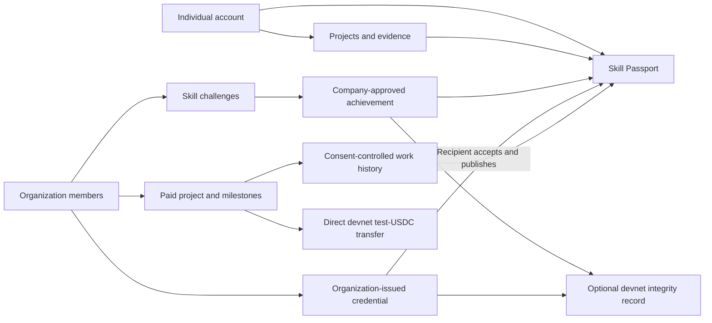

# ProofPak: Complete Product and Technical Audit

**Audit date:** 5 November 2026, Asia/Karachi.  
**Audited checkout:** `fix-wallet-specific-connection`, commit `e40ce266c13e5187c660d162f32db2b94b9b4a0a`.  
**Scope:** actual pages, actions, APIs, database migrations, chain verification, dependencies and safe local tests. Previous delivery documents were not treated as proof that something works.  
**Changes made by this audit:** this report only. No application changes, dependency upgrades, hosted migrations, live record changes, deployment, wallet signatures or blockchain transactions.

**Quick navigation:** [Executive summary](#1-executive-summary) · [Architecture](#2-current-repository-architecture-and-deployment) · [Features](#3-complete-feature-inventory) · [Solana](#4-solana-integration-assessment) · [Journeys](#5-four-complete-user-journey-assessments) · [Trust](#6-credential-trust-assessment) · [Usability](#7-product-usability-findings) · [Testing/security](#8-security-and-testing-findings) · [Roadmap](#9-prioritized-development-roadmap) · [First task](#10-recommended-first-development-task)

## How to read the findings

- **Code evidence** means the implementation exists and was inspected.
- **Local test evidence** means the relevant tests passed in this environment. It does not establish production behavior.
- **Configured Supabase evidence** means read-only metadata was obtained from the service configured in this environment. It is **not confirmed to be the service used by the production deployment**.
- **Production evidence** would require the deployed website, its actual environment and real account journeys. These could not be confirmed during this audit.
- A **database policy**, or RLS policy, determines which records a person may read or change. It does not automatically hide individual fields in a readable record.
- A **hash** is a fingerprint of a particular set of data. A matching blockchain fingerprint does not prove the data was truthful.

## 1. Executive summary

### What ProofPak is today

ProofPak is an existing professional-record application with four connected product areas:

1. A shareable Skill Passport containing profile information, skills, portfolio projects, company challenge achievements, accepted credentials and consent-controlled completed paid work.
2. Practical challenge reviews and direct credentials from organizations approved on ProofPak.
3. Discovery of unpaid challenges and single-worker paid projects.
4. Direct milestone payments using a specific devnet test-USDC mint on Solana.

This is not a freelance-only platform, and there is no architectural reason to turn it into one. The passport is the natural destination for evidence and recognition from the other activities.

The implementation is substantial. It has permission-checked database workflows, recipient consent, versioned integrity claims, signed wallet ownership challenges and a carefully constrained payment verification path. However, **a large amount of locally tested code is not the same as a demonstrated, production-ready service**.

### Most important findings

| Priority | Finding | Practical consequence |
| --- | --- | --- |
| P0 | Next.js 16.4.0 is flagged by the dependency audit; the build command stops with `SecurityFatalError`, including on retry. | Do not treat the checkout as ready for a new public release just because compilation and browser tests pass. Establish a patched, reproducible release baseline first. |
| P0 | Public paid-project rows include internal worker and linked-record identifiers. | Consent-controlled passport work history does not fully prevent public discovery of a project/worker association through the database API. This is a schema-policy issue, not a missing CSS rule. |
| P0 | There is no verified live, two-account run covering authentication, review, wallet signing, settlement and passport display in this audit. | Demonstration readiness remains unproven. Offline fixtures must not be presented as that evidence. |
| P1 | Challenge achievements and general credentials are separate records and workflows. | Approving a challenge does not send a credential to My Credentials or start recipient acceptance. A company must issue a separate credential manually if wanted. |
| P1 | Generic organization approval enables every supported credential type; direct issuance does not store the issuing representative. | An approved company/community is not technically restricted from issuing a degree-type record, and direct issuance accountability is incomplete. |
| P1 | Draft paid-project terms cannot be edited; there is no general project cancellation or accepted-terms amendment flow. | A typo or changed scope can create an abandoned draft or leave an active agreement without an in-app resolution. |
| P1 | Feedback, offers and credentials have no product notification delivery. | Users must return to the right dashboard and refresh to discover important changes. “Feedback sent” is not an email or notification service. |
| P2 | Credential evidence commitments fingerprint a URL, not the contents of the linked file/page. Revocation remains offchain. | The platform can detect changed committed records, but cannot guarantee an external artifact remained unchanged or let an offline verifier learn current revocation status. |

### What passed and what did not

- **Passed now:** lint, TypeScript, 60 unit tests, all six isolated database/security suites, and 126 Chromium desktop/mobile browser cases.
- **Build blocked:** normal production build and its retry compiled/type-checked/generated routes, then exited with the security guard. This is a failed production build command, not a clean pass.
- **Browser qualification:** browser cases ran against freshly compiled isolated E2E output, with Supabase/service-role/Reown/cron variables blank for the test server. The local start command was used separately after the build guard stopped the build. No guard was patched or disabled. This demonstrates local rendering and fixture behavior, not release clearance.
- **Read-only external confirmation:** the allowlisted devnet mint is present, initialized, six-decimal, and owned by the expected Token Program. The configured Supabase service exposes metadata for all 36 application tables and 43 functions; email signup is enabled and email confirmation is required.
- **Not confirmed:** production commit, production Supabase mapping, hosted RLS/trigger definitions, authentication email delivery, production auth redirects, live wallet compatibility, or any actual credential/payment transaction.

**Recommendation:** strengthen and demonstrate the existing product. Do not start another redesign or a replacement architecture.

## 2. Current repository, architecture and deployment

### 2.1 Branch and release state

Remote refs were fetched read-only during the audit:

| Item | Verified result |
| --- | --- |
| Local branch | `fix-wallet-specific-connection` |
| Local HEAD | `e40ce266c13e5187c660d162f32db2b94b9b4a0a` |
| Remote feature branch | `96795c8858279506efd14f3c2875146a23a3298e` |
| Remote main | `c92cf0a8b59b65c59ab94ac2224580c51f15c7b8`, merge of PR #7 |
| Local vs remote feature branch | Local is one commit ahead, zero behind. |
| Local vs main | Local is one commit ahead and four commits behind in Git ancestry. The four main-only commits are merge commits, not four missing feature implementations. |
| Actual code difference from main | 22 files from the local `e40ce26` visual-consistency refinement. Earlier wallet, credential, opportunities, homepage and dashboard work is present on both histories. |
| Initial working tree | Clean. This audit leaves only the new report uncommitted. |

Preserved local ancestors include `6ccef15` (wallet simplification), `3ccb99b` (credential presentation), `96795c8` (opportunity UX), `ba6850a` (dashboard journeys), the homepage redesign and `cc18f69` navigation/recipient-URL fixes.

**Do not assume `e40ce26` is deployed.** It is not on the fetched remote feature branch or main. GitHub deployment/check API access returned Forbidden, and production HTTP requests were blocked by the environment proxy.

### 2.2 Technology and execution model

| Layer | Current implementation | Evidence |
| --- | --- | --- |
| Web application | Next.js 16.4.0 App Router; React/React DOM 19.3.0; TypeScript 5.9.3 installed. | `package.json`, `package-lock.json`, `src/app/` |
| Runtime | Node engine `>=24.19.0 <25`; npm commands use Node’s environment-proxy support. Node type definitions are still on the 20.x line. | `package.json` |
| UI | Existing ivory/sand/burnt-orange/near-black CSS, shared components, Lucide icons. Tailwind packages are installed, but much of the visual implementation is explicit CSS. | `src/app/globals.css`, `src/components/ui.tsx`, `forms.tsx`, `portal-nav.tsx` |
| Authentication | Supabase email/password, SSR cookies, confirmation code exchange, recovery and resend forms. “Talent/company” is a starting workspace preference, not a privileged security role. | `src/lib/actions.ts`, `src/lib/supabase/server.ts`, `src/proxy.ts`, `src/app/auth/callback/route.ts` |
| Data | Supabase PostgreSQL exposed through Supabase clients. Ordinary actions use the signed-in user and RLS; financial/proof/ownership recording uses narrowly gated server endpoints and server-only service privileges. | `src/lib/credential-actions.ts`, `paid-actions.ts`, `src/app/api/` |
| Permissions | Company memberships (`owner`/`reviewer`), platform administrator table, organization status, recipient ownership and project-party checks. | Nine migrations listed below |
| Solana | Devnet only. Wallet Standard for extension/in-app-browser providers; message signing for ownership; Memo transactions for achievements/credentials; SPL `transferChecked` for payments. | `src/lib/proof.ts`, `credential-proof.ts`, `payment-chain.ts`, `wallet-ownership.ts` |
| SDK mix | `@solana/kit` 8.4.0, `@solana/web3.js` 3.0.2, and a separately named legacy 1.98.4 package for compatibility. | `package.json`, `src/lib/wallet-session.ts` |
| Optional legacy adapter | Reown 1.8.24 remains for existing signing-session handling. It is not required for normal Phantom/Solflare extension linking. | `src/lib/wallet-pairing.ts`, `wallet-connection.ts` |
| Deployment | Next-compatible Vercel deployment. One scheduled reconciliation endpoint, daily at `0 0 * * *`; endpoint max duration is 60 seconds. | `vercel.json`, `src/app/api/payments/reconcile/route.ts` |
| File handling | External evidence URLs; no implemented private document-upload pipeline or storage bucket policy migrations. | Project/qualification/credential forms and migrations |



### 2.3 Environment variables: required names, not values

Presence below refers only to this execution environment, not Vercel. No values or credentials were printed.

| Variable | Purpose | Here |
| --- | --- | --- |
| `NEXT_PUBLIC_SUPABASE_URL` | Selects the Supabase service. Public configuration, not proof that its schema is ready. | Present |
| `NEXT_PUBLIC_SUPABASE_PUBLISHABLE_KEY` | Browser/user Supabase access, subject to database policies. | Present |
| `SUPABASE_SERVICE_ROLE_KEY` | Server-only wallet, proof and financial recording. Never expose to client code. | Present |
| `NEXT_PUBLIC_SITE_URL` | Email confirmation/recovery redirect base. | Present |
| `SOLANA_RPC_URL` | Server-side devnet verification and reconciliation. Keep any provider key server-only. | Present |
| `NEXT_PUBLIC_SOLANA_RPC_URL` | Browser devnet transaction submission. Must be suitable for public exposure. | Present |
| `CRON_SECRET` | Authenticates scheduled payment reconciliation. | **Absent locally**; deployed value unknown. |
| `NEXT_PUBLIC_REOWN_PROJECT_ID` | Optional legacy session support, not required for ordinary extension linking. | Present |
| `PROOFPAK_E2E` | Test-only fixture mode. Never enable as a product feature in production. | Test runner sets it only for isolated checks. |

Sources: `.env.example`, `src/lib/supabase/server.ts`, `payment-server.ts`, `src/app/api/wallets/route.ts`, `src/app/api/payments/reconcile/route.ts`.

For a release, confirm the actual Vercel deployment’s Supabase URL, site URL, devnet RPCs and cron configuration. Supabase should allow the actual site’s confirmation callback and recovery callback, including `/auth/callback?purpose=recovery`. Preview domains need explicit appropriate redirect configuration. These settings were not verified from Vercel/Supabase dashboards.

### 2.4 Database migrations and intended objects

There are **nine migrations**. Files are intended schema history, not evidence they were applied to production. Do not rerun the initial migration or apply anything based solely on this report.

| Migration | Intended effect |
| --- | --- |
| `supabase/migrations/202610110001_initial.sql` | Profiles, companies, memberships, skills, portfolio projects, challenges, submissions, reviews, achievements, original v1 blockchain proofs; signup trigger; initial RLS and workflow functions. |
| `supabase/migrations/202610120001_passport_foundation.sql` | Profile preview timestamp; project skills; proof version column; immutable approved claims/evidence snapshots; achievement sharing/project association; backfill with integrity checks; tighter private-project access. |
| `supabase/migrations/202610120002_organizations_credentials.sql` | General organizations; platform admins; private approval audit records; direct credentials, evidence, recipient preferences, revocation events and private university review requests. |
| `supabase/migrations/202610120003_credential_proofs.sql` | Separate v3 credential-proof records and server-only recording function. |
| `supabase/migrations/202610120004_wallet_ownership.sql` | Expiring ownership challenges, verified wallet associations, purpose/uniqueness constraints and guarded disconnect function. |
| `supabase/migrations/202610120005_paid_projects.sql` | Single-worker projects, applications, immutable offers, milestones, submitted work and reviews; party permissions and workflow transitions. |
| `supabase/migrations/202610120006_milestone_payments.sql` | Explicit payout authorizations, payment intents/templates/signed attempts/receipts, wallet locks, settlement recording and completion rules. |
| `supabase/migrations/202610120007_paid_work_history.sql` | Immutable completed-work facts and separately controlled evidence; company consent plus recipient publication. |
| `supabase/migrations/202610120008_payment_workflow_guards.sql` | Reject remaining applicants after worker acceptance; allow either eligible project party to cancel only an unsigned preparation. Not a project-cancellation system. |

The configured Supabase service returned OpenAPI metadata for **36 application tables and 43 functions**. This supports object presence in that configured service. It does **not** establish migration ledger entries, exact policy/trigger definitions, data integrity, backups or production-service mapping.

#### All 36 tables, in plain English

| Group | Tables and purpose |
| --- | --- |
| Identity and portfolio | `profiles`: passport owner and visibility. `companies`: organization-facing identity fields. `company_memberships`: owner/reviewer access. `skills`: vocabulary table; working profile/project skills are also text arrays, not a normalized skills assessment system. `projects`: owner-added portfolio work and URLs. |
| Challenges | `challenges`: brief, skills, difficulty, deadline. `challenge_submissions`: one person’s current submission per challenge. `submission_reviews`: reviewer, decision and feedback. `achievements`: approval-created recognition. `blockchain_proofs`: achievement transaction/hash/version. |
| Passport evidence | `achievement_claims`: immutable issuer/evidence claim snapshot. `achievement_evidence`: private or shared approved submission snapshot. `achievement_sharing`: recipient’s evidence choice and optional related project. |
| Organization trust | `platform_administrators`: privileged human reviewers. `organizations`: organization type, status and company link. `issuer_authorizations`: private review note, administrator, identity digest and time. |
| General credentials | `credentials`: immutable issued facts. `credential_evidence`: URL and digest salt. `credential_preferences`: recipient acceptance/publication choices. `credential_events`: append-only revocation. `qualification_requests`: private university verification request/review. `credential_proofs`: v3 devnet integrity record. |
| Wallets | `wallet_ownership_challenges`: one-use expiring signed-message requests. `wallet_connections`: verified address, owner, purpose, organization and disconnect/lock state. |
| Paid work | `paid_projects`: published brief, selected worker and current agreement references. `paid_milestones`: deliverables/amounts/work status. `paid_project_applications`: private pitch/evidence. `paid_project_offers`: terms snapshots, version/hash and response. `paid_milestone_submissions`: private work versions. `paid_milestone_reviews`: reviewer/feedback/decision. |
| Payments | `paid_payout_authorizations`: worker’s explicit destination choice. `payment_intents`: approved obligation and pinned payer/recipient/asset. `payment_attempts`: template, signed bytes/signature and outcome checks. `payment_receipts`: unique confirmed settlement. |
| Published work history | `paid_work_history`: safe public-facing completed facts plus disclosure choices. `paid_work_evidence`: separately shared evidence snapshot. |

### 2.5 Dependencies and security advisories

`npm audit --json` reported **34 affected dependency entries: 1 critical, 18 high, 15 moderate**. This is a dependency-report total, not 34 proven exploitable application vulnerabilities. Transitive packages and shared dependency chains contribute multiple entries.

Important results:

- **Next.js 16.4.0:** audit reports critical SVG image-optimization and typed-array `use cache` issues, and a high App Router Server Actions denial-of-service issue. References returned by the audit: [GHSA-2464-fhr4-w9xw](https://github.com/advisories/GHSA-2464-fhr4-w9xw), [GHSA-673q-mjm6-r5xr](https://github.com/advisories/GHSA-673q-mjm6-r5xr), [GHSA-p3m5-59mp-jv5r](https://github.com/advisories/GHSA-p3m5-59mp-jv5r). The report marks ranges through 16.4.0. No exploitation was attempted. This app uses Server Actions; other advisory preconditions require separate review. Absence of a visible image widget is not sufficient to declare an installed server endpoint safe.
- **Reown dependency chain:** high findings propagate through its adapters/controllers and unrelated wallet/payment dependencies. The main wallet connection UI no longer needs generic pairing, but legacy signing-session code still imports Reown lazily. Remove or update only after checking those actual references.
- **Legacy Solana dependency chain:** moderate `jayson`/related findings appear beneath Reown, buffer-layout utilities and `solana-web3-legacy`. Do not describe the root v3 SDK alone as the vulnerable legacy package.
- **Nested Zod:** high report entries are under Coinbase/Reown subdirectories. The root validation dependency is 4.6.6; do not claim its root installation is the same affected nested copy.
- **`bigint-buffer`:** high buffer-overflow advisory appears transitively: [GHSA-3gc7-fjrx-p6mg](https://github.com/advisories/GHSA-3gc7-fjrx-p6mg). Application reachability needs investigation.

`npm outdated` initially failed because its default cache directory could not be created. Retrying with a temporary cache succeeded. The registry reported, among others:

| Package | Installed | Registry latest observed |
| --- | --- | --- |
| Next.js / eslint-config-next | 16.4.0 | 16.4.5 |
| React / React DOM | 19.3.0 | 19.3.1 |
| Supabase JS | 2.117.3 | 2.119.0 |
| Solana Kit | 8.4.0 | 8.6.0 |
| Solana web3.js | 3.0.2 | 3.1.1 |
| Playwright | 1.64.0 | 1.64.1 |
| Root Zod | 4.6.6 | 4.6.7 |
| TypeScript | 5.9.3 | 7.0.2 |

“Latest” is not an instruction to upgrade every package or cross major versions. Next/React are pinned and will not move just because a compatible-looking release exists. Review advisory-fixed ranges and SDK compatibility, then upgrade in a separately authorized development task. **No dependency was changed during this audit.**

## 3. Complete feature inventory

### Status definitions

- **Fully implemented and tested — local:** a bounded behavior was actually exercised locally. This does not mean production verified.
- **Implemented, E2E unverified:** code and often unit/SQL/UI evidence exist, but the actual authenticated user-to-service/wallet journey was not completed here.
- **Partially implemented:** an important step or lifecycle capability is missing.
- **Not implemented:** no working workflow was found.
- **Broken or blocked:** a current check or capability cannot complete as required.

### A. Build Your Passport

| Feature | Status | Actual behavior and evidence |
| --- | --- | --- |
| Registration/login | Implemented, E2E unverified | Email/password with validation, schema precheck and workspace preference. Auth metadata confirms signup enabled in configured service; actual email/session journey not run. `src/lib/actions.ts:signUp/signIn`, `src/app/sign-up/page.tsx`. |
| Email confirmation | Implemented, E2E unverified | `/auth/callback` exchanges a code; resend exists. Delivery, templates, redirect allowlist and cross-device PKCE behavior remain manual. |
| One account, multiple workspaces | Fully implemented and tested — local | Talent/company preference changes navigation. Membership/admin tables determine privileges. `src/lib/dashboard-navigation.ts`, `src/components/portal-nav.tsx`, SQL suites. |
| Basic profile editing | Implemented, E2E unverified | Name/headline/university/location/bio, step-specific updates, readable validation errors. `src/lib/profile-setup.ts`, `src/lib/actions.ts:saveProfileStep`. |
| Guided setup/progress | Fully implemented and tested — local | About, skills, work, preview/publish; optional information can be skipped. `src/components/profile-setup-form.tsx`, `src/lib/profile-setup.ts`, `src/lib/passport.ts`, portal route and browser tests. |
| Skills | Implemented, E2E unverified | Text-list skills on profiles/projects. No externally assessed proficiency score or verification merely for adding a skill. `src/lib/validation.ts`, `profile-setup.ts`, initial/Phase 1 migrations. |
| Experience timeline | Partially implemented | Bio, projects and completed paid work provide experience evidence. No general employment-role/date timeline or independent work-history verification workflow. `src/lib/types.ts:Profile`, `PassportPaidWork`. |
| Profile photo | Not implemented | Initials are generated from the name. No implemented photo-upload workflow. `src/components/passport-view.tsx`. |
| Project create/edit/remove | Implemented, E2E unverified | Owner-filtered update, insert only for creation, confirmation for removal; at least one evidence link required. `saveProject/deleteProject`, `project-editor.tsx`, `passport-actions.tsx`; local tests cover ownership. |
| Project evidence | Implemented, E2E unverified | GitHub/demo/other HTTP(S) links and descriptions; not hosted file uploads or immutable copies of external content. |
| Public passport URL | Implemented, E2E unverified | `/talent/[slug]`, unique slug, public-only lookup; copy uses current origin. `src/lib/data.ts:publicPassport`, `src/app/talent/[slug]/page.tsx`. |
| Publication/privacy | Implemented, E2E unverified | Account-wide profile public/private state plus separate credential/evidence/work-history choices. No per-project public/private field; publishing a profile makes its portfolio projects readable. Phase 1 `projects_read`. |
| Credential display | Implemented, E2E unverified | Accepted records and publication checks, with issuer/validity labels. `src/components/passport-credentials.tsx`, `credential-record.tsx`. Database read errors silently remove this section; absence can be mistaken for no credentials. |
| Challenge achievement display | Implemented, E2E unverified | Company-approved records and chosen submission evidence, optional related owner project. Not the same as accepted general credentials. `passport-view.tsx`, `achievement_sharing`. |
| Completed paid-work display | Implemented, E2E unverified | Fully settled project, company consent, worker publication and separately shared evidence; amounts omitted from history. `passport-paid-work.tsx`, migration 007. Public base-project identifier exposure remains a separate issue. |
| Sharing | Fully implemented and tested — local | Copy-link and fallback behavior; no fake generated share URL. `passport-actions.tsx`, credential sharing tests. |
| Password reset/resend | Implemented, E2E unverified | Email request, recovery callback and password update; generic account-existence responses. `sendReset/resendConfirmation/resetPassword`. |
| Account deletion/export | Not implemented | No user-facing export/delete lifecycle. Immutable references and irreversible onchain records need an explicit policy, not a naive delete button. |
| Loading/error handling | Partially implemented | Loading boundaries, retry/error pages and form messages exist. Some query failures are treated as empty/absent sections. `src/app/error.tsx`, `passport-credentials.tsx`, `passport-paid-work.tsx`. |

### B. Prove Your Work

| Feature | Status | Actual behavior and evidence |
| --- | --- | --- |
| Organization registration | Implemented, E2E unverified | University/training/community/hackathon/company/other, backed by company + membership. No supplied-logo upload pipeline. `registerOrganization`, migration 002. |
| Administrator approval | Implemented, E2E unverified | Private review queue/detail, note and confirmation; self-authorization blocked in SQL. `src/app/issuer-admin/`, `authorize_issuer`, local authorization tests. |
| Administrator provisioning | Partially implemented | A trusted operator must provision `platform_administrators` separately. Signup cannot grant this role, and there is no public self-approval/admin-provisioning flow. Migration 002 and admin route checks. |
| Independent issuer identity verification | Partially implemented | Human review is requested outside the app. No registry/domain challenge/accreditation integration or standardized review evidence workflow. Approval is a ProofPak decision. |
| Scoped credential authority | Not implemented | Current approval is generic. `issue_credential` does not restrict degree/course/etc. to appropriate approved capabilities or organization type. |
| Challenge creation/publication | Implemented, E2E unverified | Members publish title/description/skills/difficulty/deadline/deliverables immediately. Can close. No supported editing/versioning interface. `createChallenge/closeChallenge`, portal create/manage routes. |
| Challenge submission/revision | Implemented, E2E unverified | URL(s), explanation, one current submission per user/challenge, revision after improvement request; SQL enforces state/ownership/deadline. `submitWork`, migration initial. |
| Review/feedback | Implemented, E2E unverified | Company member approval or improvement request with feedback; reviewer ID/time stored. No scored rubric. `reviewSubmission`, `submission_reviews`. |
| Challenge achievement issuance | Implemented, E2E unverified | Approval creates achievement and immutable evidence/issuer snapshot. No recipient acceptance step for that achievement. Phase 1 trigger and `review_submission`. |
| Direct credential issuance | Implemented, E2E unverified | Eight supported credential types; public passport slug/full URL; authorized organization; cannot issue to yourself. `credentialInput`, `issueCredential`, `issue_credential`. |
| Invite unregistered recipient | Not implemented | No email invitation, pending claim token or safe later-account-claim flow. Direct recipients must already exist; private recipients can use the university-request path. |
| Acceptance/publication | Implemented, E2E unverified | Recipient explicitly accepts/declines and chooses visibility/evidence. Acceptance alone is not publication or chain verification. `CredentialInboxItem`, `respond_credential`. |
| Private qualification request | Implemented, E2E unverified | Private URL-based university review; approved requests create a private degree credential for acceptance. No automatic university database lookup. `qualification_requests`, `review_qualification_request`. |
| General private certificate upload/verification | Not implemented | External URLs only. An uploaded/linked document would not be independently verified simply by existing. |
| v1/v2/v3 hash rules | Fully implemented and tested — local | Deterministic/versioned claims, salted evidence, legacy compatibility. `proof.ts`, `credential-proof.ts`, `proof-record.ts`; unit and migration preservation tests. |
| Actual devnet anchoring UI | Implemented, E2E unverified | Wallet signs/submits Memo transaction; server checks finalized matching transaction before recording. `proof-anchor.tsx`, `credential-anchor.tsx`, proof APIs. No real signing/broadcast performed during audit. |
| Public verification page | Implemented, E2E unverified | Real RPC checks from server, hash/signer/Memo comparison, separate validity/issuer/recipient/integrity states. `src/app/verify/[id]/page.tsx`, `src/app/credentials/[id]/page.tsx`. |
| General credential revocation | Implemented, E2E unverified | Append-only event/reason; current validity separate from old chain integrity. `revoke_credential`, `credential_events`. Reason may be publicly visible with a public credential; form does not explicitly label it public. |
| Credential correction | Partially implemented | Revoke and issue a new credential, manually referencing the old ID in description. No structured replacement link/correction chain. |
| Challenge achievement revocation | Not implemented | Immutable achievements have no corresponding withdrawal/appeal lifecycle. |
| Reviewer accountability | Partially implemented | Challenge reviews, qualification reviews and revocations identify actors. Direct `credentials` lack `issued_by`; approval-history rows lack a distinct recorded authorize/suspend decision field. |
| Assessment criteria/appeals | Partially implemented / Not implemented | Free-text deliverables and feedback exist. Formal assessment criteria, scores, second review and appeals do not. |

### C. Find Opportunities

| Feature | Status | Actual behavior and evidence |
| --- | --- | --- |
| Unified discovery | Implemented, E2E unverified | `/opportunities` loads published, non-expired challenges and projects using public projections. No fake live fallback. `loadLiveOpportunities`, `OpportunityBrowser`. |
| Search/type filters | Fully implemented and tested — local | Title/organization/summary/skills and All/Challenges/Paid Projects. Search covers up to 100 newest open rows of each type, not an unlimited server-side index. |
| Separate challenge catalog | Implemented, E2E unverified | `/challenges`, search and details. Its published query does not filter deadlines like unified discovery; cards can show expired challenges without an equally explicit closed badge. |
| Bounties/prize competitions | Not implemented | No bounty/reward/currency/prize pool or winner-payout model. Do not describe unpaid challenges as bounties or paid opportunities. `Challenge` type, initial migration. |
| Paid-project applications | Implemented, E2E unverified | Private pitch/evidence; duplicates prevented; company cannot apply to its own project. `applyPaidProject`, `apply_paid_project`, UI and SQL tests. |
| Candidate review/selection | Implemented, E2E unverified | Organization reviews applications, selects one applicant, sends terms; others rejected after acceptance by migration 008. |
| Candidate acceptance | Implemented, E2E unverified | Accept/decline frozen offer; decline reopens project, accepted worker fixed. |
| Invitations | Not implemented | Worker selection follows application; no independent invitation flow. |
| Shortlisting/saved candidates | Not implemented | No shortlist records or working shortlist interface. |
| Talent directory | Partially implemented | Up to 100 newest public profiles with evidence links. No employer search/filter/shortlist workflow. `/portal/company/directory`. |
| Contact/messaging | Not implemented | External evidence/organization sites are links, not an in-product contact or hiring process. |
| Notifications | Not implemented | No product email/in-app alerts for offers, reviews, credentials or payments. Supabase auth emails are separate. |
| Privacy/permissions | Partially implemented | Applications, offers and private work are party restricted; public profiles require publication. Public paid-project row identifiers need further protection. |

### D. Earn From Your Skills

| Feature | Status | Actual behavior and evidence |
| --- | --- | --- |
| Paid-project creation | Implemented, E2E unverified | Company, description, requirements, skills, deadline, total budget and 1–20 milestones; totals/limits checked in UI/server/SQL. `PaidProjectEditor`, `createPaidProject`, migration 005. |
| Draft review/publish | Implemented, E2E unverified | Draft is private, publishing explicit. There is no edit/delete/cancel workflow for mistakes. |
| Worker selection/agreement | Implemented, E2E unverified | Single worker; versioned terms snapshot/hash; explicit response. No teams or bidding wars. |
| Accepted amendments | Not implemented | Terms cannot silently change, which is correct. Mutually agreed amendment/version negotiation is also absent. |
| Milestone submission/feedback/revisions | Implemented, E2E unverified | Accepted worker submits URLs/explanation, member reviews or requests revision; prior versions/reviews retained. |
| Approval vs payment | Fully implemented and tested — local | Work status and payment status are distinct; approval alone cannot create a receipt. SQL and payment verifier tests. |
| Wallet linking | Implemented, E2E unverified | Phantom/Solflare extension or supported in-app-browser provider; ownership challenge/signature mandatory. No supported desktop-to-phone QR. `wallet-manager.tsx`, `src/app/api/wallets/route.ts`. |
| Ownership/replay/purpose guards | Fully implemented and tested — local | Five-minute nonce, authenticated user/purpose/organization binding, Ed25519 validation, one-use DB consumption and active-scope uniqueness. No private keys stored. |
| Payout authorization | Implemented, E2E unverified | Selected worker must explicitly choose a verified personal wallet for the project. Payment destinations remain pinned. `authorize_project_payout`. |
| Company payer permission | Fully implemented and tested — local | Only owners pay; verified company-payer association for the correct organization is required. Does not grant credential signing. |
| Exact USDC transfer preparation | Implemented, E2E unverified | Integer units, devnet/mint/program/decimals validation, balance/fee/rent prechecks, fixed associated token accounts. `paymentNetwork`, `buildPaymentTransaction`, payment API. |
| Real wallet signing/broadcast | Implemented, E2E unverified | User signs exact template, server registers signed bytes before browser broadcast. Not executed with a real wallet here. |
| Finalization/settlement verifier | Fully implemented and tested — local | Finalized success, exact signed bytes, correct signer/accounts/mint/amount/decimals and historical balance changes. Offline transaction fixtures, not live settlement. `verifyPaymentSettlement`. |
| Duplicate prevention | Fully implemented and tested — local | Unique active intents/attempts; unique receipt milestone/signature; permission-checked server-only settlement; serializing row locks. Migrations 006/008 and tests. |
| Recovery/history | Implemented, E2E unverified | Check original signature, resume only same signed bytes, cancel unsigned preparation, show pending/failed/needs-review/paid. Browser recovery and privileged server paths exist. |
| Background reconciliation | Partially implemented | Daily cron, secret authentication, batch up to eight attempts. Local secret absent, deployed schedule/secret unknown; sequential RPC checks may exceed the 60-second handler budget. |
| Completed work record | Implemented, E2E unverified | All milestones must have verified receipts to complete project; company + recipient consent before passport display. Not an automatically issued credential. |
| Project cancellation/refunds/disputes | Not implemented | Cancelling an unsigned payment preparation is not cancelling the contract. No project-level cancellation, refund, dispute or support-resolution workflow. |
| Escrow/protected funds | Not implemented | Direct payments only. Funds are not locked; approval does not force a company to pay. |
| Mainnet/real earnings | Not implemented | Network/mint restrictions explicitly prevent mainnet use. Current test tokens have no monetary value. |

## 4. Solana integration assessment

### 4.1 What is actually signed, submitted and stored

| Action | Wallet signature? | Transaction? | Where the result lives |
| --- | --- | --- | --- |
| Create/edit/publish passport or project | No | No | Supabase |
| Submit/review a challenge | No | No | Supabase, including review and achievement snapshot |
| Issue/accept/revoke a general credential | No | No | Supabase. Revocation is not currently a new onchain event. |
| Link a wallet | Yes, ownership message | **No transaction** | Server-verified ownership record in Supabase |
| Anchor challenge achievement | Yes, transaction signature | Devnet Memo with `proofpak:v1:` or `proofpak:v2:` hash | Solana transaction; signature/hash/version/signer saved in Supabase |
| Anchor accepted general credential | Yes, authorized linked issuer wallet | Devnet Memo with `proofpak:v3:` hash | Solana plus `credential_proofs` |
| Pay milestone | Yes, payer transaction signature | Create/ensure recipient token account, `transferChecked`, payment Memo | Actual devnet token balances plus private DB intent/attempt/receipt |
| Share completed paid work | No | No new transaction | Consent-controlled Supabase record |

Sources: `src/components/proof-anchor.tsx`, `credential-anchor.tsx`, `milestone-payment.tsx`; `src/app/api/proofs/route.ts`, `credential-proofs/route.ts`, `wallets/route.ts`, `payments/route.ts`.

The code does not mint credentials as NFTs, create speculative tokens or use Solana Attestation Service. It implements hash anchoring and actual SPL-token transfer instructions.

### 4.2 Claim protection and legacy behavior

- **v1 achievements:** commits achievement ID, challenge ID, company ID and issue timestamp. It does not bind all modern achievement facts, notably title/recipient/evidence. Historical proofs must retain that narrower meaning.
- **v2 achievements:** adds recipient, issuer name, title/type, submission reference and salted approved-evidence digest. Snapshots are immutable. New achievement proofs use v2; legacy v1 recovery is limited by eligibility/cutover checks.
- **v3 general credentials:** commits credential/recipient/organization IDs, issuer name, approval reference, title/type/description, issue/expiry dates, program/award, evidence digest and creation timestamp.
- Serialization uses fixed property order and SHA-256. v2/v3 evidence salts prevent easy guessing of private URLs from a public digest.
- **Evidence is not a captured document:** v3 hashes salted evidence URL text. v2 hashes approved description/deliverables/URL(s)/explanation. Neither automatically archives the linked file, repository commit, website or official event result.

Exact sources: `src/lib/proof.ts:canonicalRecord/claimV2/serializeRecord/evidenceDigest`, `src/lib/proof-record.ts:achievementRecord/canRecoverLegacy`, `src/lib/credential-proof.ts:credentialClaim/serializeCredential/credentialEvidenceDigest`.

### 4.3 What public verification really checks

`checkAnchor` and `checkCredentialAnchor` confirm the RPC’s devnet genesis hash, retrieve a **finalized** transaction, check successful execution, find the expected Memo and verify the recorded wallet signed it. The page recomputes the claim hash rather than trusting the stored badge alone.

`credentialIntegrity` separates pending, mismatch, failed, missing, unavailable and verified outcomes. General credential pages separately show acceptance, validity/revocation, issuer status and blockchain integrity. A revoked credential can still have a matching historical transaction; the UI correctly does not equate those facts.

**The limit:** an independent chain reader can confirm the commitment/signature, given the right claim/hash. It cannot establish a university’s legal identity, the quality of assessment, who physically completed the work, the student’s real-world identity or the truth of a degree. Public recipient names are current profile display names; the claim binds an account ID, not an independently checked legal person.

Private evidence may remain unavailable to public verifiers. They can compare the committed digest, but cannot independently inspect a document they have not been permitted to see.

Sources: `src/lib/solana.ts`, `credential-solana.ts`, `credential-verification.ts`, `proof-status.ts`, public verification routes and `credential-detail.tsx`.

### 4.4 Wallet permissions are not identical across proof versions

- General v3 credential anchoring requires current approved organization membership **and** an ownership-verified `credential_issuer` wallet. Ownership timing is checked against the transaction time before saving.
- Company milestone payments require an owner’s separate `company_payer` wallet and a worker’s explicit payout authorization.
- Challenge v1/v2 anchoring authenticates a company member and checks the signing transaction, but `/api/proofs` does **not** require that signer to have an organization-scoped wallet connection like v3 does. This is a weaker association, not equivalent issuer-wallet authorization.
- Ordinary profile creation, portfolio work, challenge submission and credential acceptance need no wallet.
- No working desktop-to-mobile QR session is offered. Extensions and supported wallet in-app browsers remain the supported route. An “existing signing session” recovery option still exists in transaction components, even though the main wallet UI no longer creates a generic Reown pairing session.

This difference should be made explicit and tightened for new proofs later without invalidating historical proof formats.

### 4.5 Can devnet payments complete from the real UI?

The UI and backend contain the required path; it is not just a signature-entry form:

1. Approved milestone and active accepted project are checked server-side.
2. Payer membership, linked purpose and recipient payout authorization are checked.
3. Devnet genesis, mint, Token Program, initialized state and six decimals are checked.
4. The exact amount is converted to integer units. The payer’s token balance, SOL fee and possible account rent are checked.
5. A fixed three-instruction transaction template is stored.
6. The wallet signs; the server verifies the signed message matches that template and durably registers the signature/bytes.
7. Only then does the browser broadcast those bytes.
8. Finalized settlement is independently fetched and checked by the server.
9. Only the restricted DB function records a unique receipt and updates the financial outcome.

The audit’s read-only devnet RPC confirmed:

- Genesis: `EtWTRABZaYq6iMfeYKouRu166VU2xqa1wcaWoxPkrZBG`.
- Mint: `4zMMC9srt5Ri5X14GAgXhaHii3GnPAEERYPJgZJDncDU`.
- Owner: `TokenkegQfeZyiNwAJbNbGKPFXCWuBvf9Ss623VQ5DA`.
- Account length 82 bytes; decimals 6; initialized.

**This does not prove a real UI payment has completed.** No wallet signed and no token transfer was sent during this audit. The actual extension/device, account capabilities, funded balances, hosted keys, RPC reliability and deployment must still be exercised together.

### 4.6 What settlement verification protects

`src/lib/payment-chain.ts:verifyPaymentSettlement` compares the exact registered signed bytes with the chain result, checks finalization/success, payer signature, expected token accounts and wallet ownership metadata, mint/program/decimals, exact `transferChecked` amount, expected Memo and actual source/destination balance changes. Extra token movement and unexpected instruction layout are rejected.

Migrations 006/008 enforce uniqueness and lock the obligation/destination. Frontend success cannot directly mark a milestone paid. Underpayment, overpayment or missing metadata produces review/unknown outcomes, not a false receipt.

If broadcast succeeded but saving failed, the system rechecks the **same signature**. Unknown outcomes must not trigger a new payment. If a signature cannot be found after blockhash expiry, the code deliberately does not assume nonpayment. This is safe but requires an operational recovery process that is not yet a full support interface.

### 4.7 Centralized dependencies and durability

ProofPak still relies on its server/Supabase for account identity, organization permissions, issuer approval, recipient consent, work review, current revocation state and the payment-to-milestone association. Service-role access is a trusted recording boundary. Database restrictions protect ordinary users; they are not a claim that a compromised privileged operator cannot lie.

Payment attempts have stronger durability than Memo attempts: payment bytes/signature are registered server-side before broadcast. Achievement/credential anchors keep pending signatures primarily in browser local storage before final server recording. Browser loss can complicate recovery. General credential recovery is also blocked if the credential is no longer accepted/current or the issuer is no longer authorized, even if an earlier transaction exists; recovery needs an explicit policy rather than bypassing those checks.

The daily reconciliation job processes at most eight attempts sequentially within a 60-second route budget. Each may require multiple RPC requests; the raw transaction request alone has a 15-second timeout. Repeated RPC exceptions can leave the same oldest rows selected again because failure paths do not reliably advance their checked timestamp. Manual recovery exists; reliable scheduled operation is not confirmed.

### 4.8 What Solana adds, and sensible future improvements

**Added value today:** a separately inspectable commitment to a particular signed record at a time, and independently observable token settlement. A normal database alone cannot supply an independent transaction history outside the platform operator’s control.

**Not added:** truthful assessment, legal issuer authority, document authenticity, guaranteed work payment, dispute resolution or private payments. Devnet history can reset, so it is not a long-term production permanence promise.

| Option | Product benefit | Recommendation |
| --- | --- | --- |
| Portable organization-signed credentials | A recipient can export and present a signed claim outside ProofPak. | Strong P2 candidate. Choose a documented credential/signature format and an issuer-key ownership/rotation model. Do not call the existing Memo a portable credential standard. |
| Better issuer identity/capability registry | Makes “who may issue what” understandable and reviewable. | Start with verified domains, representative authority, credential-type permissions and audit events. Consider public signed/onchain key references when useful. |
| Revocation/status registry | External verifiers can learn a previously valid record was withdrawn. | Add signed status information first or a carefully designed append-only onchain status commitment. Preserve original transactions. |
| Immutable artifact references | Proves which file/version the issuer assessed, not just which URL was supplied. | Record content hashes, repository commit IDs and versioned evidence metadata while preserving private-document access. |
| Onchain escrow | Can demonstrate funding was reserved before work begins. | Later, only with explicit release, cancellation, dispute and recovery rules and appropriate audits. It does not solve dishonest assessment automatically. |
| Custom Solana program | Can enforce a genuine onchain lifecycle that existing primitives cannot. | Not the next task. Do not create one merely to increase technical complexity or hackathon appearance. |

## 5. Four complete user-journey assessments

### Common demonstration preconditions

A repeatable demonstration needs an exact preview/release commit, matching reviewed schema, working auth email redirects, confirmed server-only recording access, devnet RPCs and an operator recovery plan. A platform administrator must already be provisioned through a separately authorized administrative process; ordinary signup does not grant that role. Confirm a usable backup/recovery point before any future authorized schema change. Metadata presence is not enough.

Use **Account A** for an individual and **Account B** for an organization owner. Organization approval also needs a platform administrator who is not a member of B’s organization. A may hold that admin role for a clearly labeled internal demo only if A is not an organization member; real institutional review should have appropriate independence. Do not fabricate a university, Superteam authorization or real award.

Any future wallet-signing/broadcast walkthrough requires separate authorization. Nothing below was executed against live accounts during this audit.

### Journey 1 — Passport

**New user → signup → profile → project → publish → share**

| Step and route | Current implementation | Test evidence / friction |
| --- | --- | --- |
| `/sign-up` | Name, email, password, preferred starting workspace; creates one account. | Validation and unconfigured failures tested. Real signup/email delivery not tested. |
| Email → `/auth/callback` → `/portal/talent` | Code exchange and dashboard routing. | Configured service requires confirmation. Redirect/template/PKCE and cross-device behavior unverified. |
| Home → `/portal/talent/profile?step=about` | Name and optional headline/university/location/introduction. | Step field whitelists tested; no requirement to join a challenge or connect a wallet. |
| `?step=skills` | Add comma-separated skills. | Text validation tested. No verified proficiency implied. |
| `/portal/talent/projects` | Add/edit work and one or more external links; remove with confirmation. | Ownership SQL and forms tested separately. No authenticated browser-to-hosted-DB test. |
| `/portal/talent/profile?step=publish` and preview | Choose slug/visibility; optional preview. | Checklist is guidance, not a gate requiring every field. |
| `/talent/[slug]` | Public only after publication; share current-origin link. | Local privacy and layout checks pass. Real public URL in an Incognito session not verified now. |

**Result:** implemented; end-to-end live demonstration unverified. A useful passport does not require paid work or challenge participation.

**Two-account check:** A publishes a project; B opens the public link signed out, then A makes the profile private and B must lose access. Verify that unrelated private portfolio work remains inaccessible to challenge reviewers. Test duplicate slug and edit validation without creating duplicate projects.

### Journey 2 — Challenge and credential

The requested joined journey is **partially connected**, because it is actually two workflows:

```text
Challenge → submission → review → automatic achievement → optional v2 Memo
                                      |
                                      | manual, not a structured issuance link
                                      v
Approved organization → direct credential → recipient accepts/publishes → v3 Memo
```

| Step and route | Current implementation | Test evidence / break |
| --- | --- | --- |
| B registers `/organizations?view=register` | Company-backed organization with pending approval. | SQL ownership/self-approval tests pass. |
| Admin `/issuer-admin/[id]` | Human external identity review, note, approve/suspend. | Self-organization authorization blocked. Actual identity verification is an operator process, not proven by a database flag. |
| B `/portal/company/create` | Publishes practical unpaid challenge. | Requires company membership, not general credential issuer authorization. |
| A `/challenges/[id]` | Submits work URLs and explanation. | Deadline, ownership and duplicate/state controls tested in SQL. |
| B `/portal/company/reviews` | Requests improvements or approves; reviewer and feedback recorded. | Revision path exists. No rubric, appeal or general achievement withdrawal. |
| Approval | Creates `achievements` plus immutable snapshot. | **Does not create a `credentials` row or recipient acceptance request.** |
| B optionally anchors achievement | Connects transaction-signing wallet; v2 Memo, finalized server check. | Code/offline verification tested; no actual wallet transaction tested. v2 lacks v3’s linked-issuer-wallet requirement. |
| B `/organizations?view=issue` | Manually selects A’s published slug/full URL and re-enters a general credential/evidence. | Requires approved issuer. No structured link tying this new credential to the approved challenge/submission. |
| A `/my-credentials` | Accept/decline, select publication/evidence, save. | Local UI consent and SQL access tests pass. No notification prompts A automatically. |
| B `/organizations?view=issued` | Accepted current credential can be anchored by a linked credential-issuer wallet. | Actual browser-wallet-RPC-server process remains unverified. |
| `/credentials/[id]` | Public only with recipient acceptance, credential publication and public profile. | Local verification/visibility tests pass; production Incognito/RPC test not completed. |

**Result:** challenge and direct-credential flows exist individually. The combined journey requires manual duplication and has no robust source relationship. Do not present automatic challenge-to-credential acceptance as implemented.

**Two-account check:** B creates a clearly labeled test challenge; A submits, receives revision feedback and resubmits; B approves. Confirm one achievement and immutable evidence. If demonstrating a general credential too, explicitly show the separate issuance step, A’s acceptance and the independently checked v3 transaction. A should not be able to review their own work or issue themselves a credential.

### Journey 3 — Opportunities

**Post → discover → apply → review → select → accept**

| Step | Implementation and limitations |
| --- | --- |
| B creates opportunity | Unpaid challenge or paid-project draft. There is no bounty type or configured prize challenge. |
| Publish/discover | Unified `/opportunities` shows real published, non-expired rows. Search/filter is local to a capped result set. |
| Challenge participation | A submits work directly; there is no application/selection stage before completing a challenge. |
| Paid-project application | A opens details and Apply; pitch + evidence URL saved privately. Duplicate and self-company applications blocked. |
| B reviews applications | The selected company can see applicants, pitches and evidence. No shortlist or comparison tool. |
| Select one worker | Creates a frozen offer/version/hash, not an immediately accepted agreement. |
| A accepts/declines | Accept starts work; decline reopens selection. Other applicants are marked rejected after acceptance. |
| Discover changes | A must check My Activity/project page; no notification delivery. |

**Result:** the paid application/selection core is implemented and SQL-tested, but not live E2E verified. Challenge participation is a different opportunity model and should stay clearly labeled.

**Two-account check:** test A’s application, B’s selection, A’s acceptance and a declined-offer retry. Also attempt an application from B’s own organization account and an unrelated account’s read of A’s private application. Add a third applicant only if demonstrating automatic rejection of remaining candidates. Do not imply an invitation or shortlist screen exists.

### Journey 4 — Paid work

**Accept → submit milestone → review/revise → approve → authorize wallets → sign/pay → confirm → share history**

| Step and page | Implementation | Test evidence / friction |
| --- | --- | --- |
| B creates `/paid-projects/new` | 1–20 milestones; exact integer budget sum/deadline validation. | SQL and editor tests; draft edits/cancellation missing. |
| A applies, B selects, A accepts | Versioned immutable offer. | SQL workflow tested; acceptance does not require a wallet. |
| A submits `/paid-projects/[id]` | Only selected accepted worker; evidence and explanation. | Revision/history states tested. |
| B reviews | Member requests revisions or approves; audit record. | Approval does not mark Paid. |
| A links Personal wallet `/wallet` | Ownership nonce/message signed and verified. | Offline real Ed25519 fixtures and SQL replay checks; no physical wallet test here. |
| A authorizes project payout | Explicit project destination, never inferred silently from another wallet. | SQL tests cover pinning and lock guards. |
| B links Organization Payments wallet | Company owner, correct organization and signed ownership. | Generic organization registration required; issuer approval not required merely to pay. |
| B prepares payment | Server checks obligation, test mint, funds/fees/rent; shows recipient/amount. | Verifier and trust-boundary tests; no real funded wallet used. |
| B signs exact transfer | Signature registered before broadcast; browser sends exact bytes. | Implemented UI; real device/network compatibility unverified. |
| Server reconciles | Actual finalized token movement checked, unique receipt stored. | Offline chain fixtures + SQL receipt/duplicate tests, not live settlement. |
| All milestones settled | Project becomes completed. | Work approval alone does not complete it. |
| Company disclosure + A publication | Completed-work record appears on published passport, with separate evidence permission. | SQL consent tested. Public base-project worker-ID exposure must still be fixed. |
| Optional credential | Approved organization may issue one separately. | Payment completion never automatically verifies a skill or issues a credential. |

**Two-account check:** A and B need distinct controlled devnet wallets; B needs test tokens matching the exact mint and devnet SOL for fee/rent. Show a revision, approval with payment still pending, explicit payout selection, exact signed transfer, finalized independent verification, both parties’ receipt, and no second payment after refresh. Simulate a lost response only in a controlled test and recover the original signature. Then test company consent and A’s publication independently.

**Result:** a plausible complete devnet payment implementation with meaningful safety controls; no audited proof of a successful real-user UI transfer. No real-money readiness claim is justified.

## 6. Credential trust assessment

### 6.1 Distinctions the product must keep

| Record | What it establishes | What it does not establish |
| --- | --- | --- |
| Owner-added skill/project | The account owner supplied it and linked evidence. | Assessed proficiency, verified employment or legal identity. |
| Submitted work | A person submitted these links/explanation for review. | Acceptance, quality, payment or credential issuance. |
| Company-reviewed achievement | A permitted member approved a challenge submission; snapshot retained. | Approved legal issuer status, degree validity, or recipient acceptance of a general credential. |
| Organization-issued credential | An organization approved on ProofPak issued immutable facts; recipient can accept/publish. | Independent accreditation, guaranteed truthful assessment or type-specific authority. |
| Issuer authorization record | A platform administrator recorded a review and identity-field fingerprint. | Automatic proof of real-world identity or a public, independent accreditation registry. |
| Blockchain integrity proof | A matching record fingerprint was signed and committed in a finalized devnet transaction. | Truth, assessment quality, legal authority, document contents or current revocation from chain alone. |
| Paid-work receipt | The specified test-token transfer settled according to strict verification. | Verified skills, employment rights or a company-issued credential. |

### 6.2 Trust gaps requiring real product decisions

1. **Organization approval is too broad for high-stakes claims.** SQL checks `issuer_status='authorized'` and membership, not whether that issuer may issue degrees, certifications or particular programs. Add reviewed capabilities and enforce them in SQL, not only the form.
2. **Direct issuance actor is missing.** `credentials` records organization and approval reference but no issuing representative. Qualification reviews and revocations have actors; direct issuance needs the same accountability.
3. **Approval history is incomplete as a decision log.** `issuer_authorizations` stores administrator, time, note and identity digest, but not a dedicated authorize/suspend decision column. Current organization status cannot reconstruct every historic transition by itself.
4. **Identity change is effectively an operator dead end.** After an authorization reference exists, `protect_reviewed_organization_identity` blocks name/website/description changes. The UI asks for a new review but provides no complete controlled identity-change process.
5. **No actual assessment standard.** Deliverables, descriptions and free-text feedback are useful, but there is no versioned rubric, evidence checklist, score or appeal/second-review process.
6. **External evidence can change.** Commit to artifact versions/content hashes where appropriate; preserve private documents and only publish with consent.
7. **Correction is manual.** A replacement ID in a description is not a structured replacement relationship. Add immutable supersession/correction events, retaining historical hashes.
8. **Challenge achievements cannot be withdrawn through the product.** Add lifecycle events/status without rewriting v1/v2 facts or transactions.
9. **Recipient acceptance is not a truth check.** It is consent to receive/publish a record. Declining is not an independent appeal or correction decision.
10. **Revocation explanation has a privacy edge.** `credential_events.reason` is displayed with a visible credential, but the issuer’s form does not explicitly call it a public reason. Separate public wording from private investigation notes.

### 6.3 Terminology to keep or improve

- Keep “Project added by you,” “Company-approved,” “Organization approval,” and “Blockchain integrity” separate.
- “Approved on ProofPak” should always mean platform approval, not a guarantee of accreditation or legal identity.
- “Onchain verified” is acceptable only for the narrow finalized matching record check, never as a standalone verified-person/verified-skill badge.
- “Feedback sent” and “credential received” should not imply an email/in-app alert when only a database record was saved.
- “Existing signing session” is a confusing legacy choice if the current wallet page cannot create such a session. Explain or remove it in a scoped compatibility task.
- Distinguish cancelling an **unsigned payment preparation** from cancelling a **paid project**.

## 7. Product usability findings

The recent design and navigation work is present and locally testable. The largest remaining usability problems concern lifecycle completion and status discovery rather than visual appearance.

| Severity | Issue | Affected evidence | Recommended direction |
| --- | --- | --- | --- |
| High | Challenge approval does not create the credential acceptance journey users may expect. | `review_submission`, `issue_credential`, portal reviews, My Credentials. | Offer an explicit, source-linked optional credential action after reviewed work; explain achievement vs credential before action. |
| High | A draft’s mistakes cannot be corrected in the existing workflow; there is no project withdrawal/cancellation lifecycle. | `protect_paid_project_terms`, paid-project detail/editor. | Allow safe pre-agreement edits; add controlled cancellation independently from payment cancellation. |
| High | Users do not learn about new offers, revision requests or credentials unless they revisit the correct page. | No product notification tables/jobs/actions. | One actionable activity/notification inbox; real opt-in email delivery later. |
| High | Unknown payments can remain locked without a usable operator resolution workspace. | `reconcilePayment`, wallet locks, `PaymentRecovery`. | Signature-first recovery queue, archival RPC investigation and clear next action; never “retry payment” by default. |
| Medium | Issued credential cards show title/issuer/date but not a clear recipient context; private-profile recipient lookup may show “Private recipient” to an issuer despite a qualification request’s name snapshot. | `CredentialRecord`, organization issued list, credential route, profile RLS. | Show permitted recipient/request identity within issuer workflows, without making private profiles public. |
| Medium | Portfolio credential/work-history query errors silently hide sections. | `PassportCredentials`, `PassportPaidWork`: `if (error) return null`. | Distinguish unavailable from no records, while not leaking private record existence to unrelated visitors. |
| Medium | Company profile, generic organization registration and owner-only payer wallet setup are distinct but easy to confuse. | Company profile, `/organizations`, wallet purposes, payment preparation. | Context-aware next-step guidance with the correct company/organization preselected and permission checked. |
| Medium | Public talent directory has little employer utility beyond opening the newest profiles. | `/portal/company/directory`, limit 100. | Search/filter by relevant public evidence and skills; consent-based contact path. Avoid building a full recruitment system first. |
| Medium | Search is capped; standalone challenge listings and unified discovery treat expired items differently. | `live-opportunities.ts`, `data.ts:challenges`, challenge cards. | Consistent open/closed labels, pagination and server-side search when dataset justifies it. |
| Medium | Expired accepted credentials can still show an anchoring control even though the API refuses non-current credentials before signing. | Organization issued view renders `CredentialAnchor` without an expiry check; `/api/credential-proofs:authorized` requires Current. | Derive visible actions from the same eligibility rules and explain why no transaction can be prepared. |
| Medium | Identity changes and revoked-record replacement lack a guided continuation. | Reviewed-identity trigger; revoke-and-reissue copy. | Reviewable identity-change requests and linked credential replacements. |
| Medium | Some authenticated lists load full collections without pagination; company counts can span memberships while profile editing selects a single company. | Portal catch-all, organization issued list and review queries. | Bounded/paginated queries, aggregate counts and explicit organization context. Do not remove auth checks to make pages look faster. |
| Medium | Transaction signing/confirmation can stay busy without the ownership flow’s consistent timeout guidance. | `milestone-payment.tsx`, `credential-anchor.tsx`, `proof-anchor.tsx` versus `wallet-session.ts`. | Cancel/timeout UI that keeps unknown outcomes unknown and preserves the signature. |
| Low/Medium | Root account preference guides login destination, while some workspace pages remember role in session storage. | `signIn`, `PortalNav`, `WorkspaceFrame`. | Test returning-user context; keep preferences separate from authorization and clearly labeled. |
| Low | Professional history is narrower than the broad homepage vision. | Profile fields, portfolio projects, completed paid work. | Add a structured owner-reported experience record only after core proof/work journeys are reliable. |

No navigation rewrite is recommended. Current primary paths are sensible: personal Home/My Profile/Opportunities/My Activity/Credentials, with Wallet/Payments/Settings secondary; organization Home/Organization & credentials/Challenges/Paid projects/Reviews. Directory access exists from the organization home, even though it is not a primary sidebar item.

## 8. Security and testing findings

### 8.1 Safe checks actually performed now

| Check | Actual result | Limits |
| --- | --- | --- |
| `npm run lint` | Passed. | Static lint, not a security penetration test. |
| `npm run typecheck` | Passed. | Does not verify hosted schema/config. |
| `npm test` | 60 passed, zero failed/skipped. | Includes versioned hashes, payment verification fixtures, ownership cryptography, navigation and validation. |
| `npm run test:db` | All six suites passed in disposable local PostgreSQL. | Not Supabase production or its currently installed policies. |
| Production build | **Blocked/exit 1** after compilation, TS and route generation; retry also blocked. | `SecurityFatalError` for vulnerable Next.js. Do not report this as a successful release build. |
| E2E compilation | Compiled isolated `.next-e2e` output, then same security halt. | Used only to run a local test server; not a deployment artifact approved for release. |
| Browser suite | **126 passed**, last-run status `passed`, no failed tests. Desktop + Chromium mobile emulation. | Supabase blank, isolated component fixtures and mocked wallet/server paths. No genuine authenticated hosted walkthrough or real extension signing. |
| Read-only configured Supabase metadata | HTTP 200; 36 table definitions and 43 function paths exposed to authorized metadata request; email signup enabled, confirmation required. | No record data exported; production mapping, exact RLS/triggers, migration ledger and backup state unconfirmed. |
| Read-only Solana RPC | Devnet genesis + allowlisted mint/program/6 decimals/initialized confirmed. | No signing, broadcast, receipt or wallet balance funding. |
| Production HTTP | Blocked by proxy CONNECT 403, including retry outside the normal sandbox. | Cannot conclude the website itself is returning that error. |
| GitHub deployment/check API | Forbidden. | Cannot confirm Vercel build state or deployed commit. |
| Dependency audit/outdated | Audit 34 affected entries; outdated retry succeeded using temporary cache. | Reported advisories require reachability/patch review; no packages upgraded. |

The first browser startup failed because the environment proxy treated localhost as an HTTP error/occupied address. Tests were then run with localhost excluded from the proxy and a temporary external runner config. The test server used blank Supabase/service-role/Reown/cron values, current compiled E2E output, 90-second test allowance and 300-second startup allowance. Application and repository test configuration were not changed.

### 8.2 What the isolated database suites establish

- `tests/database.sql`: challenge creation/submission/revision/approval, public passport behavior and forbidden writes.
- `tests/credentials-database.sql`: organization approval boundaries, no self-authorization, issuance/acceptance, evidence privacy, requests, revocation and immutable facts.
- `tests/wallet-database.sql`: no client privileged wallet writes, one-use challenges, own-wallet visibility/disconnect, expiry and payment lock guards.
- `tests/paid-projects-database.sql`: draft/public visibility, applications, selection, acceptance, revisions, review, fixed terms and private work.
- `tests/payment-database.sql`: privileged settlement recording, pinned wallets, locks, receipt/signature uniqueness, completion and work-history consent.
- `tests/legacy-before.sql` / `legacy-after.sql`: migration preserves existing table rows and historical v1 proof fields.

Passing these tests does not establish that the deployed database has the same definitions or that every sensitive column has an appropriate public exposure rule.

### 8.3 Concrete security findings

#### S1 — Critical release blocker: vulnerable framework and security-stopped build

Evidence: installed Next.js 16.4.0, `npm audit` and two `SecurityFatalError` build exits. P0 upgrade/compatibility work is necessary. No exploit was attempted, and the exact exposure of every advisory is not proven. Do not bypass the guard to deploy or run a blind automatic dependency fix.

#### S2 — High privacy gap: readable public paid-project rows contain worker identifiers

Evidence: migration 005 defines `paid_projects_read` as `status <> 'draft' OR member`, grants SELECT to `anon`, and keeps `worker_id`/`current_offer_id` in that table. Migration 006 adds `payout_authorization_id`. The public detail route uses `select("*,companies(name)")`.

A published/offered/active/completed project is readable at the row level. RLS does not remove individual columns, so an anonymous database client can request internal association fields even if the UI only shows a safe listing DTO. This is **not a finding that private submission evidence or payment receipts are publicly readable**; those have separate restrictive policies. It is a real exposure in the intended schema, not a confirmed extraction from the production database.

Fix through reviewed public projections/column privileges or separated public/private records, preserving authorized party access. Add anonymous API/SQL tests that check fields, not just whether a private evidence table is inaccessible. Consider the already-public original opportunity and budget when describing confidentiality: passport opt-out cannot erase an earlier public listing.

#### S3 — High trust gap: issuer authority and accountability are underspecified

Evidence: migration 002 `issue_credential` accepts all enumerated credential types for any authorized organization member; no `issued_by` column; authorization history lacks an explicit decision field. This is not proof someone has abused it. It is inadequate for broad degree/certification trust claims without further capability enforcement and review evidence.

#### S4 — Medium operational gap: recovery relies on privileged server and human intervention

Payment verification is conservative, which is appropriate. However, unresolved archival/RPC failures can leave wallets and work history locked. There is no complete operator case-management flow. Credential Memo attempt storage is less durable than payment attempt storage. Improve recovery without providing an unsafe “mark paid” switch.

#### S5 — Medium availability/abuse risk: no application-level rate limits found

Wallet ownership challenge creation, proof preparation/verification and sensitive review endpoints lack a visible application rate-limit policy. Supabase may impose authentication/provider limits, but that is not a per-user product abuse policy. RPC-heavy public verification can consume quota. Add quotas, bounded request bodies, challenge retention and privacy-safe monitoring before scale.

#### S6 — Medium evidence/privacy limitation: external URLs are not private storage

Database RLS prevents many unauthorized reads, but cannot revoke a third-party public link or freeze mutable content at that URL. Sensitive qualification documents should use access-controlled storage or restricted institution links, with content/version commitments and explicit publication choices.

#### Existing strengths to preserve

- No client private-key or seed-phrase storage.
- Server-only service-key paths with explicit auth checks, origin checks and RLS-constrained lookups before privileged work.
- User metadata preference is not administrator/company authorization.
- Locked, immutable approved facts and accepted terms.
- Server signature verification and consumed nonce challenges.
- Devnet genesis and mint/program checks.
- Unique payment obligations/receipts and no frontend “mark paid” endpoint.
- Correct separation of historical integrity from revocation/expiry/current issuer status.
- E2E fixtures are gated by test mode plus unconfigured Supabase; not a fake production fallback.

This is a product/security code audit, not a comprehensive penetration test or a smart-contract audit.

Application code does not visibly enforce MFA/step-up authentication for issuer administrators. Hosted Supabase MFA settings were not inspected. Strengthen privileged-account authentication as institutional trust and financial exposure grow; a wallet signature still remains separate from account login. Some update actions also check database errors without checking affected-row counts, so stale permissions should be tested for misleading success messages.

### 8.4 Missing integration/security tests

The highest-value missing test is a real authenticated, two-account, preview-environment journey. Add the following without using production fixtures:

1. Signup, confirmation email, cookie/session refresh, logout, reset and resend with actual hosted auth.
2. Public/private transitions tested as owner, unrelated authenticated user and anonymous visitor, including direct REST queries and sensitive columns.
3. Company member vs owner vs platform administrator, and a member of an unrelated organization.
4. Type-specific credential authority; direct issuance actor; approval event reconstruction; linked corrections and public revocation reason handling.
5. Browser form → actual Supabase action → second account’s view, not separately mocked UI plus SQL only.
6. Real Phantom and Solflare message signing and transaction signing on the supported physical devices.
7. A deliberately approved small devnet transfer, server finalization and receipt, refresh/retry recovery, then consent-controlled passport work display.
8. RPC outage, missing archival transaction, registration-success/HTTP-response-loss, process interruption and successful-chain/failed-DB-save recovery.
9. Direct API bypass attempts and concurrent payment requests beyond sequential local fixtures.
10. Build/deploy/schema configuration drift and background reconciliation throughput under the actual hosting plan.

## 9. Prioritized development roadmap

**Do not implement these from the report automatically.** These are proposed tasks for approval. Existing blockchain v1/v2/v3 formats and historical records must remain verifiable. Any schema change should be additive, reviewed and applied only with release authorization.

### P0 — Critical blockers and protection of existing journeys

#### P0.1 — Restore a secure, reproducible release build

- **Type:** fix existing infrastructure/security blocker.
- **Problem/why:** vulnerable installed runtime; build fails its security guard. Adding product features before this leaves release confidence unresolved.
- **Evidence:** `package.json`, `package-lock.json`, audit advisories and build logs.
- **Change/files:** review fixed Next/React ranges, align `eslint-config-next`, assess affected transitive packages; update only compatible necessary dependencies and lockfile. Review server-action/image/cache exposure; never suppress the guard for release.
- **Dependencies/complexity:** none before starting; **Medium** because auth, wallet SDK and transaction serialization regressions need checking.
- **Acceptance:** clean production build with no security halt, documented remaining advisories/reachability, TypeScript/lint/unit/SQL/browser checks, preview smoke test, unchanged legacy claim test vectors.

#### P0.2 — Remove unintended public worker-association fields

- **Type:** fix existing privacy boundary.
- **Problem/why:** public row readability exposes selected worker and linked identifiers independent of passport work-history consent.
- **Evidence:** migration 005 `paid_projects_read`, migration 006 added column, paid-project detail `select(*)`.
- **Change/files:** design safe public views/projections and column/row access rules; preserve party-only internal queries. Requires a separately reviewed additive migration and updates to `paid-data.ts`, discovery/detail queries and tests if necessary.
- **Dependencies/complexity:** identify every existing reader; **Medium**.
- **Acceptance:** anonymous/unrelated REST and SQL cannot retrieve private association fields; public title/skills/budget remain accessible; applicant, selected worker and company workflows still work; existing records preserved.

#### P0.3 — Establish one deployment/schema/auth baseline and repeatable live walkthrough

- **Type:** validate/fix existing integration, not a new product feature.
- **Problem/why:** current hosted deployment and correct production DB mapping are unconfirmed, despite local metadata and tests.
- **Evidence:** local `e40ce26` ahead of remote branch; proxy/API blocks; no live transaction evidence from audit.
- **Change/files:** improve `scripts/check-services.mjs` coverage beyond initial/Phase 1 tables, plus deployment/demo documentation and test-only account fixtures. Add explicit schema-version/configuration health checks, not automated production migration application.
- **Dependencies/complexity:** P0.1, reviewed environment access; **Medium**.
- **Acceptance:** exact preview commit, intended DB definitions/RLS, real confirmation/reset URLs, two real accounts, one complete passport/challenge/credential and a separately authorized devnet payment walkthrough with preserved receipts/signatures. Record any manual operator steps honestly.

### P1 — Essential improvements across all four pillars

#### P1.1 — Connect reviewed work to credential issuance without replacing the passport

- **Type:** extend existing workflows; new structured source relationship.
- **Problem/why:** challenge approvals create achievements, not general accepted credentials; companies re-enter facts manually.
- **Evidence:** `reviewSubmission`, `issueCredential`, separate `achievements`/`credentials` schemas.
- **Change/files:** explicit optional “Issue credential from reviewed work,” immutable source references and permission checks. Keep the existing achievement and recipient acceptance/publication choices. Define a new claim version if new protected claim fields are introduced.
- **Dependencies/complexity:** P0 baseline and issuer scope decisions; **Medium**.
- **Acceptance:** source company/recipient/work must match; cross-company issuance denied; no duplicate automatic credentials; historical proofs unchanged; recipient can decline.

#### P1.2 — Add issuer capabilities and issuance accountability

- **Type:** strengthen existing trust permissions plus new audit fields.
- **Problem/why:** generic approval can issue degrees; direct issuing representative and authorization decision history are incomplete.
- **Evidence:** migration 002 `issue_credential`, `credentials`, `issuer_authorizations`.
- **Change/files:** reviewed allowed credential types/program scopes, immutable issuing actor, explicit approve/suspend events. Enforce in SQL and issuance/proof APIs, not only menus. Update organization/admin UI and tests.
- **Dependencies/complexity:** written approval policy and manual migration review; **Medium**.
- **Acceptance:** authorized community cannot issue a degree unless separately permitted; unauthorized member cannot issue/revoke; every new issuance and approval transition identifies a responsible actor; old claims retain their original version.

#### P1.3 — Complete draft editing and safe cancellation

- **Type:** complete existing paid-project lifecycle.
- **Problem/why:** terms are frozen even in drafts, and an active project cannot be ended through a defined workflow.
- **Evidence:** `protect_paid_project_terms`, project editor, no project-cancel function.
- **Change/files:** allow controlled edits before agreement; explicit withdrawal/cancellation states and party acknowledgments where required. Never silently change accepted terms or cancel an unresolved signed transfer. `paid-actions.ts`, project pages, migrations 005/006-compatible additive changes.
- **Dependencies/complexity:** payment state model and recovery policy; **Medium/Large**.
- **Acceptance:** editable draft, protected accepted scope, cancellation with no payment attempt, refusal with unresolved signed attempt, preserved historical reviews/receipts.

#### P1.4 — Make important changes discoverable

- **Type:** new notification capability supporting existing workflows.
- **Problem/why:** users miss offers, credentials and revision requests; status records alone are not a notification.
- **Evidence:** no product notification delivery; “Feedback sent” action wording.
- **Change/files:** compact activity inbox/deep links for review, acceptance and payment action; truthful delivery state; opt-in email only with configured sending infrastructure. Update action copy meanwhile.
- **Dependencies/complexity:** reliable event creation after successful DB transitions; **Medium**.
- **Acceptance:** one action item per transition, correct recipient only, no duplicate alerts on retry, no private evidence in email, completed action closes the prompt.

#### P1.5 — Improve employer use of public passports

- **Type:** extend existing directory; contact is a new feature.
- **Problem/why:** opening the newest 100 profiles is not a strong repeat employer reason to return.
- **Evidence:** portal directory query/display, no shortlist/contact storage.
- **Change/files:** public skills/evidence search and useful filters; lightweight saved profiles and recipient-controlled contact route. Keep portfolio/evidence primary, not CV ranking or a full applicant-tracking system.
- **Dependencies/complexity:** permission/consent design and pagination; **Medium**.
- **Acceptance:** employer finds a relevant public project/credential, private accounts remain absent, no contact information exposed without consent, saved profiles respect later privacy changes.

#### P1.6 — Fix absent-versus-unavailable states and query scaling

- **Type:** improve existing reliability/usability.
- **Problem/why:** silently missing credentials/work history and unbounded review lists reduce confidence; organization context can be unclear.
- **Evidence:** `PassportCredentials`, `PassportPaidWork`, portal/organization collection queries.
- **Change/files:** appropriate unavailable states, bounded pages/count queries, consistent organization selection, expired challenge labels. Preserve request-scoped auth caching and RLS.
- **Dependencies/complexity:** P0 integration baseline; **Small/Medium**.
- **Acceptance:** forced query failure is not “no records,” public pages do not leak private existence, large local datasets paginate correctly, sidebar feedback remains immediate.

#### P1.7 — Make payment recovery and scheduled checks operable

- **Type:** complete reliability of existing payment functionality.
- **Problem/why:** daily eight-item sequential job and unknown outcomes need a safe operator path; local cron secret is absent.
- **Evidence:** `reconcilePayment`, cron route, `vercel.json`, `PaymentRecovery`.
- **Change/files:** execution-budget-aware batches, retries/backoff, fair queue selection, read-only archival investigation, audit trail and clear pending/review messaging. Consider durable Memo attempts as well. Do not add a casual “mark paid” or force-unlock shortcut.
- **Dependencies/complexity:** confirmed hosting/RPC plan and P0.3; **Medium**.
- **Acceptance:** successful-chain/failed-save recovery uses original signature; unavailable RPC does not repay; queue progresses under failures; unsigned cancellation remains allowed but signed unknown attempts remain protected.

#### P1.8 — Support teams and institution representatives safely

- **Type:** complete membership management, not team payment splitting.
- **Problem/why:** owner/reviewer records exist but no safe invitation/revocation workflow for staff; general membership grants broad issuing/review powers.
- **Evidence:** `company_memberships` schema/functions and absence of team UI.
- **Change/files:** owner-managed invitations, least-privilege credential/review/payer permissions and controlled membership removal with audit history. Preserve owner-only payment authorization.
- **Dependencies/complexity:** issuer capabilities, pending wallet/payment policy; **Medium**.
- **Acceptance:** invite acceptance cannot join the wrong organization; reviewer cannot authorize payments; removing access prevents new privileged actions without erasing historical evidence.

### P2 — Stronger trust, meaningful Solana and professional utility

#### P2.1 — Versioned assessment criteria and appeals

- **Type:** new trust/lifecycle capability.
- **Problem/why:** free-text approval alone is weak evidence of an assessed skill, and mistakes have no appeal path.
- **Evidence:** challenge deliverables/free-text feedback, review tables, no appeal/rubric records.
- **Change/files:** simple criteria checklist/rubric snapshot, reviewer rationale and a controlled second-review/appeal process. Add challenge achievement withdrawal events without editing historical facts.
- **Dependencies/complexity:** stable reviews and issuer accountability; **Medium/Large**.
- **Acceptance:** approved record identifies the criteria/evidence version; appeal does not rewrite an old review; resolved reversal is visible without claiming the old transaction disappeared.

#### P2.2 — Portable signed credentials and issuer-key governance

- **Type:** new interoperability capability.
- **Problem/why:** the current share URL and Memo depend on ProofPak to explain the claim and issuer authority.
- **Evidence:** public page, private authorized preparation API, v3 canonical claim and wallet associations.
- **Change/files:** documented exportable signed format, official issuer-key mapping, rotation/revocation and recipient privacy rules; optional Solana commitment remains a separate layer.
- **Dependencies/complexity:** issuer capabilities, durable identity review, lifecycle decisions; **Large**.
- **Acceptance:** another verifier validates an exported permitted claim and issuer signature without copying ProofPak UI logic; altered claims fail; suspended/rotated keys and private data behave correctly.

#### P2.3 — Better evidence commitments and current-status portability

- **Type:** strengthen existing integrity model; new artifact/status metadata.
- **Problem/why:** URL fingerprints do not freeze artifact contents; chain alone cannot reveal current revocation.
- **Evidence:** `credentialEvidenceDigest`, `evidenceDigest`, offchain `credential_events`.
- **Change/files:** content/commit hashes and versioned private evidence; linked replacement credentials; signed/public status lists or append-only status anchoring where justified. Preserve all old serialization rules.
- **Dependencies/complexity:** P1 trust/issuer work; **Medium/Large**.
- **Acceptance:** changing a linked file/version can be detected; unauthorized people cannot fetch a private document; an external verifier learns revocation separately from historical integrity.

#### P2.4 — Privacy-safe evidence storage and professional history

- **Type:** new controlled upload/experience capability, plus existing privacy improvements.
- **Problem/why:** external sensitive links may be public; profile experience is limited; useful approved work can remain unpaid and absent from paid history.
- **Evidence:** URL-only qualification forms, `Profile` type, project completion gate.
- **Change/files:** private buckets/signed access, retention and export policy; optional owner-reported experience; distinguish approved delivery from paid settlement without creating fake credentials or automatic publication.
- **Dependencies/complexity:** privacy design, P0.2, agreement lifecycle; **Medium/Large**.
- **Acceptance:** private objects cannot be guessed/downloaded; withdrawal stops future access; self-reported employment is labeled; unpaid approved work is never labeled paid; all public disclosure remains consensual.

#### P2.5 — Observability, abuse controls and real-user acceptance automation

- **Type:** operational hardening/new integration tests.
- **Problem/why:** local test success misses email, physical wallets, provider outages, abuse and deployment drift.
- **Evidence:** missing app rate limits, public RPC verification, test fixture design and blocked production inspection.
- **Change/files:** redacted event/error logging, rate limits, nonce cleanup, health/schema drift checks and a dedicated hosted-test environment with two-account integration tests. Cache only safe immutable proof results; current consent/revocation and user authorization must stay current.
- **Dependencies/complexity:** known environments and sender/RPC budgets; **Medium**.
- **Acceptance:** detect broken emails/schema/RPCs without logging secrets; reject abusive requests; demonstrate complete journeys on every candidate release; historical claims still verify.

### P3 — Advanced features after the core earns repeat use

#### P3.1 — Genuine bounties/reward challenges

- **Type:** new feature, not a renamed existing challenge.
- **Problem/why:** opportunity vision includes bounties, but reward rules, selection and payout are absent.
- **Evidence:** no prize fields in `challenges`, no bounty model.
- **Change/files:** explicit opportunity type, eligibility, winner rules, budget/reward disclosure and authorized payment lifecycle. Reuse verified payment/evidence infrastructure where suitable.
- **Dependencies/complexity:** reliable direct payments, assessment and disputes policy; **Large**.
- **Acceptance:** unpaid remains unpaid; a configured prize is visible accurately; winner authorization and duplicate prevention tested; no unsupported guaranteed-payment claims.

#### P3.2 — Funded agreements/escrow only for a demonstrated need

- **Type:** new financial product and potentially audited onchain program.
- **Problem/why:** direct payment leaves nonpayment risk, but escrow introduces custody/release/dispute risks.
- **Evidence:** current direct-only model and absent disputes/refunds.
- **Change/files:** first specify funding, acceptance, release, timeout, cancellation, refund and dispute rules; assess audited existing primitives/partners before a custom program.
- **Dependencies/complexity:** P1 lifecycle/recovery, legal and security review, real demand; **Large**.
- **Acceptance:** independently audited failure/recovery tests and explicit user disclosures before real value. Never label current direct payments escrow.

#### P3.3 — Mainnet and real-user financial launch

- **Type:** new release capability; not an environment-variable flip.
- **Problem/why:** current mint/network are test-only and no disputes/support/real-money operational readiness is established.
- **Evidence:** devnet genesis/mint checks, no commissions/refunds/mainnet configuration.
- **Change/files:** network/asset configuration and safe migration plan, mainnet-grade RPC/reconciliation, audits, key controls, customer support, Pakistan-relevant legal/regulatory/tax review and stablecoin risk disclosure. Decide fees only after product value is proven.
- **Dependencies/complexity:** all payment/core trust work and external review; **Large**.
- **Acceptance:** separate approved real-money launch checklist, verified asset identity, reliable support/recovery, no test token represented as money, independent security review and staged limits.

#### P3.4 — Broader employer/institution integrations

- **Type:** new features after demand is validated.
- **Problem/why:** recruiting integrations, institutional registries and recommendations are not yet core reliability fixes.
- **Evidence:** directory and manual issuer processes are the current limits.
- **Change/files:** consent-based integrations that add records/evidence to the same passport; no disconnected second platform and no automatic “verified” badge from AI matching.
- **Dependencies/complexity:** repeat employer use, portable credentials and stable permissions; **Large**.
- **Acceptance:** measurable repeated use, accurate provenance, privacy boundaries and a complete supported journey before adding another category.

## 10. Recommended FIRST development task

**Authorize a focused security-baseline task: upgrade the vulnerable framework to a reviewed patched version and restore a clean reproducible production build, while preserving all credential versions, wallet ownership and payment invariants.**

Deliver only the necessary dependency/configuration compatibility changes, updated regression evidence and a preview candidate. Do not combine it with new features, a redesign, mainnet or production database changes. Review the public paid-project column exposure immediately afterward, before inviting real users under stronger privacy promises.

The next acceptance milestone should then be one recorded, repeatable two-account demonstration covering a passport, reviewed work, accepted credential and a separately approved real devnet payment. That proves the existing four pillars connect. More screens or a custom Solana program will not substitute for that evidence.

### Founder-shareable summary

ProofPak’s original vision is intact: one professional passport supported by projects, reviewed work, credentials, opportunities and optional paid work. The code implements substantial functionality across all four pillars. It does not need a rebuild or a freelance-only pivot.

Local checks passed: TypeScript, lint, 60 unit tests, six isolated database/security suites and 126 desktop/mobile browser tests. However, the production build is blocked by a reported Next.js security vulnerability. Browser fixtures do not prove real signup, issuer review, wallet signing or settlement on the hosted website.

Priority gaps are the vulnerable runtime, public paid-project identifier exposure, unverified live integration, generic issuer authority, missing direct-issuance accountability, disconnected challenge-to-credential issuance, and incomplete cancellation/notification/recovery workflows. Solana currently provides real hash anchoring and a real token-transfer implementation; it does not prove issuer honesty, guarantee payment or make devnet tokens money.

First fix the release security baseline, then privacy and a repeatable two-account live demo. Improve issuer trust, employer usefulness and portable evidence next. Add bounties, escrow or mainnet only after the existing product reliably serves users.

## Appendix A — Route and workflow map

| Routes | Audience / purpose |
| --- | --- |
| `/`, `/how-it-works` | Public product explanation and entry paths. |
| `/opportunities`, `/challenges`, `/challenges/[id]` | Public discovery/details; submission requires a real account. |
| `/paid-projects`, `/paid-projects/[id]` | Public published opportunities; private application/agreement/review/payment sections limited to the appropriate account/party. |
| `/paid-projects/new` | Company-member draft creation. |
| `/talent/[slug]` | Published passport; no login required for permitted public records. |
| `/credentials/[id]`, `/verify/[id]` | Credential and challenge-achievement verification; visibility rules still apply. |
| `/sign-up`, `/sign-in`, `/auth/callback` | Account creation/login/confirmation. |
| `/forgot-password`, `/reset-password`, `/resend-confirmation` | Account recovery and confirmation resend. |
| `/portal/talent` | Personal task-led home. |
| `/portal/talent/profile`, `/projects`, `/passport`, `/preview` under the same prefix | Guided editing, portfolio management, owner view and preview. Implemented through one catch-all portal route. |
| `/portal/talent/activity`, `/submissions`, `/achievements`, `/settings`, `/browse` under the same prefix | Personal activity, challenge results, evidence choices, settings and browsing. |
| `/portal/company`, `/profile`, `/create`, `/challenges`, `/reviews`, `/directory` under `/portal/company` | Organization home/profile, challenge creation/management/review and public talent directory. |
| `/organizations?view=overview/issue/issued/requests/register` | Membership-scoped organization and credential workflows. Not a list of every organization’s private management data. |
| `/issuer-admin`, `/issuer-admin/[id]` | Platform administrator review only; own-organization decisions blocked. |
| `/wallet`, `/payments` | Optional linked wallets and private payment management. |
| `/api/wallets` | Authenticated nonce/ownership verification, no blockchain transaction. |
| `/api/proofs`, `/api/credential-proofs` | Authorized preparation/recording and signature-status checks for Memo proofs. |
| `/api/payments` | Permission-checked prepare/register/resume/reconcile/cancel-unsigned actions. |
| `/api/payments/reconcile` | Secret-authenticated scheduled check of existing signed attempts, not a transfer sender. |
| `/test-ui` | Isolated E2E fixture route only; proxy and page gate it when configured Supabase or ordinary production mode is present. |

## Appendix B — Evidence and limits retained locally

Raw validation artifacts are outside the repository, not application changes:

- `/tmp/proofpak-audit-checks.log`: lint, TypeScript, unit results.
- `/tmp/proofpak-audit-build.log`, `/tmp/proofpak-audit-build-retry.log`: failed release build commands and security guard.
- `/tmp/proofpak-audit-db.log`: six isolated PostgreSQL suite results.
- `/tmp/proofpak-audit-e2e-build.log`: compilation plus security stop for isolated E2E output.
- `/tmp/proofpak-audit-browser-final.log`: 126 passing browser cases. Earlier startup logs record the proxy/localhost problem; they are not hidden as application failures.
- `/tmp/proofpak-audit-dependencies.json`, `/tmp/proofpak-audit-outdated-retry.json`: dependency findings as reported, no fix applied.
- `/tmp/proofpak-audit-supabase-metadata.json`: schema names and auth booleans only; no user records or credentials.
- `/tmp/proofpak-audit-rpc.json`: read-only public devnet mint confirmation.
- `/tmp/proofpak-audit-public.json`: blocked production HTTP attempts, not live website validation.

No report conclusion relies on an earlier delivery document saying a transaction or deployment succeeded. Where that evidence is absent, the feature remains explicitly end-to-end unverified.
